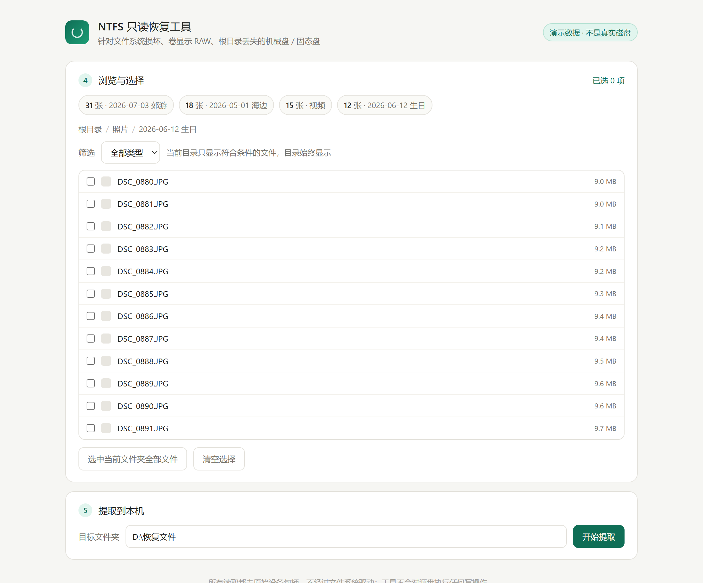

# Herramienta de recuperación NTFS de solo lectura

[English](README.md) | [简体中文](README.zh-CN.md) | [日本語](README.ja.md) | **Español** | [Deutsch](README.de.md)

Una herramienta web local que extrae archivos de un volumen NTFS dañado: ese que Windows muestra como **RAW**, se niega a abrir y te ofrece formatear una y otra vez.

Lee el disco en bruto, recorre toda la MFT (Master File Table) y reconstruye el árbol de directorios a partir de la referencia al directorio padre que guarda cada registro. Por eso sigue funcionando aunque el propio directorio raíz haya sido destruido, y conserva los nombres de archivo y la estructura de carpetas originales.

**Solo lectura: nunca escribe en el disco de origen.**

---



## Por qué funciona cuando otras herramientas fallan

Las herramientas convencionales recorren la cadena *volumen → directorio raíz → subdirectorio → archivo*. Si el registro n.º 5 de la MFT —el directorio raíz— está dañado, esa cadena se rompe en el primer eslabón. Windows marca el volumen como RAW, la mayoría de las herramientas ven un disco vacío, y las que siguen adelante recurren al *carving* por firmas, que descarta todos los nombres de archivo.

Los registros de archivo de NTFS son **autocontenidos**. Cada registro de 1024 bytes contiene el nombre del archivo, el número de registro de su directorio padre y los clústeres donde residen sus datos. Por eso esta herramienta ignora por completo el directorio raíz:

1. lee el sector de arranque para obtener la posición inicial de la MFT y el tamaño de clúster
2. resuelve las propias runas de datos de `$MFT` — la MFT también es un archivo y puede estar fragmentada en cientos de extensiones repartidas entre varios registros
3. recorre secuencialmente todos los registros de la MFT y extrae de cada uno la *referencia al padre + el nombre*
4. agrega en sentido inverso para reconstruir todo el árbol

---

## Características

- **Sobrevive a un directorio raíz destruido** — la causa más común de que un volumen se vuelva RAW
- **Conserva nombres y carpetas** — a diferencia del *carving* por firmas
- **Cualquier tipo de archivo** — fotos, vídeos, documentos, comprimidos; no filtra por extensión
- **No se bloquea con sectores defectuosos** — cada bloque se lee en un hilo con tiempo de espera; las zonas ilegibles se omiten y se contabilizan
- **Interfaz web local** — lista de discos, diagnóstico, progreso del escaneo, árbol de carpetas, filtro por tipo, progreso de extracción
- **Resultados en caché** — reabrir la herramienta no obliga a reescanear
- **Sin frameworks ni compilación** — servidor HTTP de la biblioteca estándar y JavaScript puro
- **Estrictamente de solo lectura** — ninguna ruta de código abre el dispositivo de origen para escritura

---

## Requisitos

- Windows (el acceso a dispositivos en bruto es específico de Windows)
- Python 3.8 o superior
- `dissect.ntfs` — opcional; solo se usa para resolver las runas de `$MFT` cuando está muy fragmentada

---

## Inicio rápido

```bash
git clone https://github.com/createBean/DiskRepairTool.git
cd DiskRepairTool
pip install dissect.ntfs
```

Luego haz doble clic en `启动.bat`. Solicita permisos de administrador por sí mismo, instala la dependencia si falta y abre la interfaz en el navegador.

O inícialo manualmente:

```bash
python server.py
```

El servidor escucha en `http://127.0.0.1:8765/`.

¿No tienes un disco defectuoso a mano? Abre `http://127.0.0.1:8765/?demo=1` para ver la interfaz con datos de ejemplo.

---

## Cómo se usa

1. **Selecciona el disco** — elige la unidad defectuosa por modelo y capacidad
2. **Selecciona la partición y diagnostica** — revisa el sector de arranque y los primeros 16 registros de la MFT e indica si el directorio raíz está dañado
3. **Escanea** — lee toda la MFT y reconstruye el árbol; una MFT con millones de registros tarda unos minutos
4. **Explora y selecciona** — navega por el árbol de carpetas y marca lo que necesites; el panel también lista las carpetas con más imágenes
5. **Extrae** — elige una carpeta de destino y empieza a copiar; el progreso y los bytes se actualizan en vivo

---

## Limitaciones

**Funciona para** corrupción lógica de NTFS: directorio raíz ausente, tabla de particiones dañada, estructuras del sistema de archivos corruptas, volumen convertido en RAW tras un corte de energía o una extracción insegura.

**No funciona para**:

- **Daño físico** — discos con clics, chirridos, caídas o mojados. No los enciendas; necesitan una sala limpia.
- **exFAT / FAT32** — estructuras en disco distintas, no implementadas
- **Volúmenes cifrados** — BitLocker / VeraCrypt deben desbloquearse primero
- **Registros sobrescritos** — si el registro de un archivo apunta ahora a clústeres reutilizados, el contenido no se puede recuperar a través de él; solo el *carving* por firmas puede ayudar, y pierde los nombres

---

## Solución de problemas

**El volumen no tiene letra de unidad.** Cuando se ejecuta con privilegios, la herramienta abre `\\.\PhysicalDriveN`, así que no hace falta letra. Sin elevación recurre a un identificador de volumen y entonces sí la necesita.

**El antivirus marca la herramienta.** Es esperable: el comportamiento (recorrer todos los discos, leer gigabytes) se parece al de un ransomware. El código es corto y auditable, y solo abre dispositivos en modo lectura.

**Un exe compilado no arranca.** Smart App Control y SmartScreen de Windows bloquean ejecutables sin firma y sin reputación. Ejecuta desde el código fuente o firma el binario.

**El escaneo no encuentra nada.** Revisa primero el diagnóstico: si el sector de arranque no es NTFS o no se pueden resolver las runas de la MFT, el volumen está dañado físicamente o usa otro sistema de archivos.

---

## Seguridad

- El programa solo lee del disco de origen; ninguna ruta de código lo abre para escritura
- Los permisos de administrador solo sirven para abrir un identificador de dispositivo en bruto
- La única escritura se realiza en la carpeta de destino que elijas
- La recuperación es de mejor esfuerzo: ninguna herramienta puede garantizar todos los archivos

---

## Licencia

MIT
